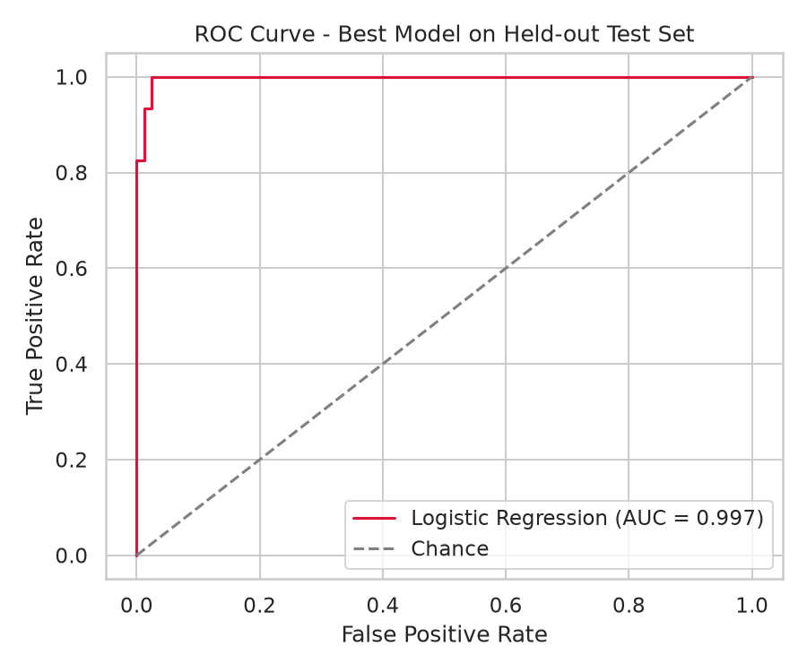
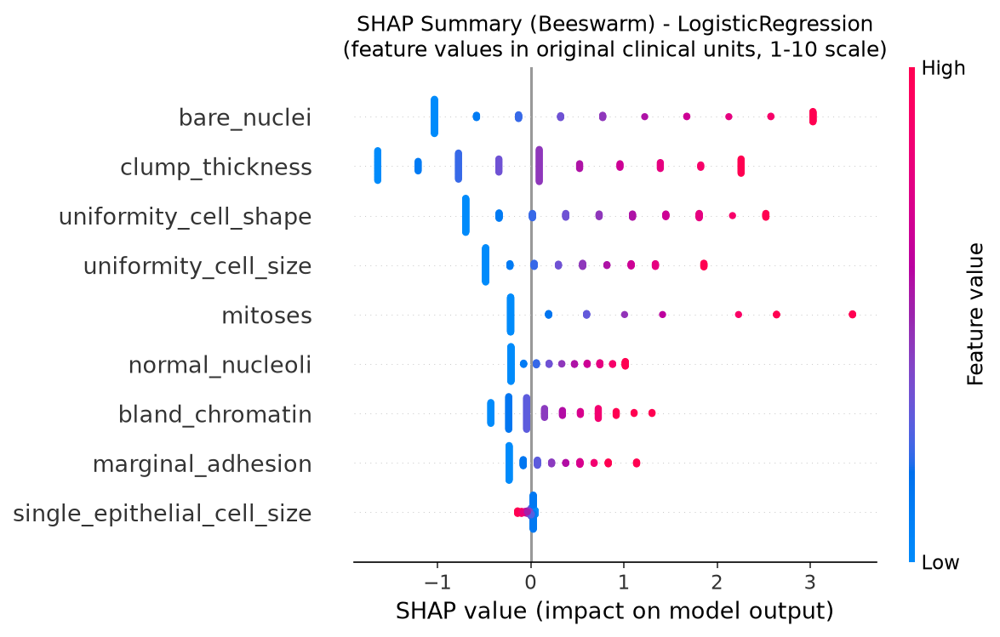
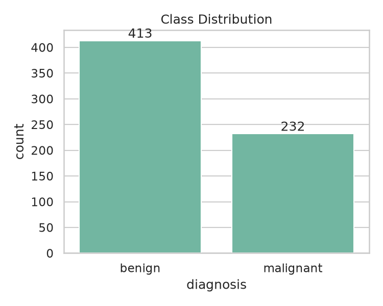
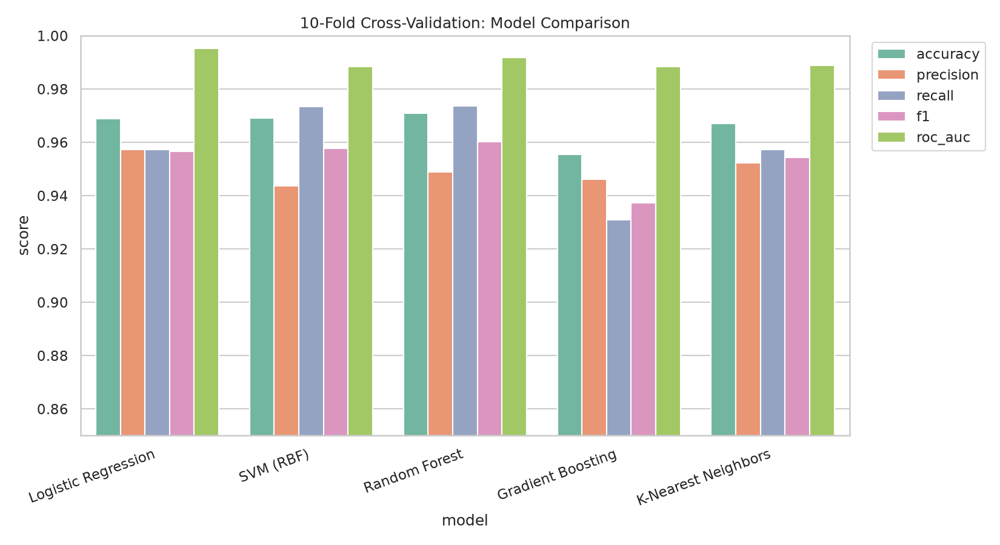
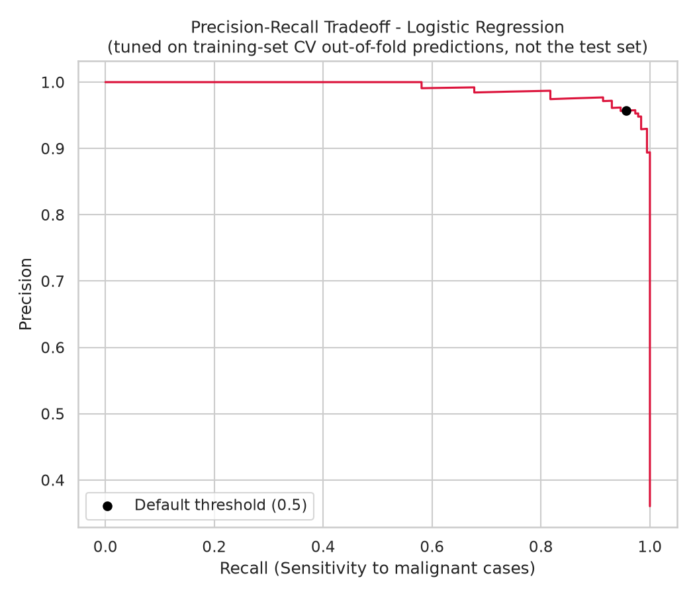
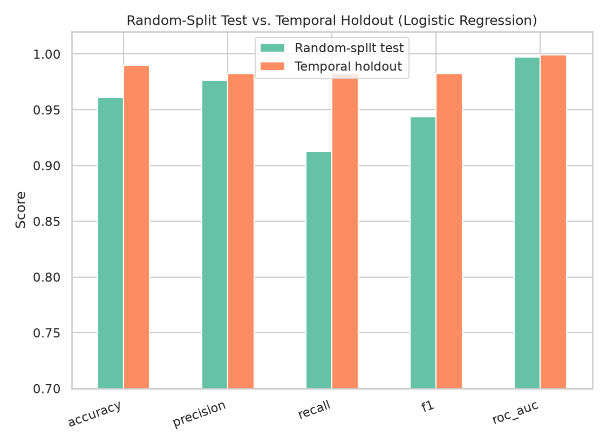

# Breast Cancer Classification (Wisconsin Original)

A classification pipeline on the UCI Breast Cancer Wisconsin (Original) dataset. The
rule I held myself to: the test set is never used to make a modeling decision. Imputation,
model selection and threshold tuning are all done on training data only.

This is a class/portfolio project, not a clinical tool.

## Results

| | |
|---|---|
| Best model (chosen by training-only CV) | Logistic Regression |
| Test accuracy | 96.1% (95% CI 92.2 to 99.2%) |
| Test ROC-AUC | 99.7% (95% CI 99.1 to 100%) |
| Test recall (malignant), threshold 0.5 | 91.3% (4 of 46 missed) |
| Test recall, threshold 0.057 tuned on training data | 100% (0 of 46 missed), with 7 false alarms instead of 1 |
| Later-30% chronological holdout, ROC-AUC | 99.9% (95% CI 99.7 to 100%) |
| Top features (SHAP) | bare nuclei, clump thickness |

Confidence intervals are 95% bootstrap intervals over the 129-patient test set (2,000
resamples). They only describe sampling noise on this one test set.

The dataset is small, comes from a single site and is very easy to separate. Summing the
nine grades with no model at all already gives 99.5% ROC-AUC, so the high scores say as
much about the data as about the model.

<p align="center">
  
  
</p>

## Data

699 raw records, 9 cytology features graded 1 to 10 (donated by Dr. William H. Wolberg,
University of Wisconsin Hospitals).

- 54 records repeat an earlier `id` (repeat biopsies). Keeping them could put the same
  patient in both train and test, so records are sorted by `id` and only the earliest
  per `id` is kept. That leaves 645 patients (413 benign, 232 malignant).
- 16 records have a missing `bare_nuclei` value. They stay as `NaN` until the model
  pipeline, where a median imputer is fit on training data only.

<p align="center"></p>

## Avoiding leakage

1. **Imputation.** The `SimpleImputer` sits inside the scikit-learn `Pipeline`, so the
   median is refit on each CV training fold and never sees test data.
2. **Chronology.** The "later" cohort is defined by sorting on `id`, not raw file order.
   The two disagree at 19 points.
3. **Threshold tuning.** The threshold is picked from out-of-fold predictions on the
   training set, then applied to the test set once.

The test set is only used to report final metrics for choices already made, and for the
SHAP and robustness analyses of the chosen model.

## Model selection

Logistic Regression, RBF-SVM, Random Forest, Gradient Boosting and k-NN are compared with
stratified 10-fold CV on the 80% training split. The best mean CV ROC-AUC wins.

<p align="center"></p>

## Threshold choice

Out-of-fold training predictions give a threshold of about 0.057, the highest value with
zero training false negatives. Applied once to the test set:

| 46 malignant, 83 benign | Threshold 0.5 | Threshold 0.057 |
|---|---|---|
| Missed malignant | 4 | 0 |
| False alarms | 1 | 7 |
| Sensitivity (exact 95% CI) | 91.3% (79.2 to 97.6) | 100% (92.3 to 100) |
| Specificity (exact 95% CI) | 98.8% (93.5 to 99.97) | 91.6% (83.4 to 96.5) |
| Precision | 97.7% | 86.8% |

Caveats:
- The threshold is set by a single training patient. Over 50 different CV shuffles it
  ranges from 0.038 to 0.072.
- Precision depends on prevalence. At 10% prevalence the same threshold gives roughly
  57% precision, and about 11% at 1%.
- Zero misses did not carry over to the later cohort, where the same procedure still
  missed 1 of 57 malignant cases.

<p align="center"></p>

## Chronological holdout

The model is retrained on the earlier ~70% of patients (451, by `id`) and tested once on
the later ~30% (194). Both come from the same institution, so this is a shift check and
not external validation. Malignancy rate drops from 38.8% to 29.4% between the cohorts.

`07_validation_audit.py` checks how far this result can be trusted:
- AUC stays between 99.8 and 100% across train fractions of 50 to 80% and both orderings
  (`id` order and file order). `id` is an accession number, not a timestamp, so neither
  is a verified clock.
- About 40% of later patients have an exact-grade twin in the earlier cohort. On the
  other 116, AUC is 99.8%.
- Model family was chosen by CV that included some later patients. Choosing on the early
  cohort alone also gives Logistic Regression.

<p align="center"></p>

## Duplicates and the 99.7% AUC

There are only 442 distinct grade combinations among the 645 patients. 50 of the 129 test
patients have an exact twin in training (all benign, all correct). On the 79 without a
twin, which include all 46 malignant cases, AUC is 99.3% (95% CI 97.8 to 100%) and all 5
test errors occur, so accuracy on novel cases is closer to 93.7% than 96.1%.

## SHAP

SHAP values are computed on the model's input space (imputed and standardized), but plots
show feature values in the original 1 to 10 grading units. `bare_nuclei` and
`clump_thickness` drive the predictions most.

## Limitations

- One institution and one collection window, so no external validation.
- Chronology is reconstructed from `id`, not recorded. 46 `id`s repeat and are resolved by
  keeping the earliest.
- Features are subjective pathologist grades. Inter-observer variability is not captured.
- 645 patients is enough to compare simple models, but the intervals are wide.
- The 0.057 threshold is dataset-specific and fragile. Re-derive it on new data.
- Gaussian noise in the robustness tests is applied to the test set in memory only. It is
  never added to training data.

The full write-up is in [`reports/Breast_Cancer_ML_Report.docx`](reports/Breast_Cancer_ML_Report.docx).

## Running it

```bash
git clone https://github.com/prachiagarwal2025/breast_cancer_project.git
cd breast_cancer_project
./run_all.sh        # fresh venv, pinned install, all scripts, Word report
```

Or step by step:

```bash
python3 -m venv venv && source venv/bin/activate
pip install -r requirements-lock.txt   # exact versions; requirements.txt has minimums only

python src/01_data_eda.py             # clean, dedupe, EDA figures
python src/02_model_training.py       # compare models, pick best, test evaluation
python src/03_explainability.py       # SHAP
python src/04_robustness_testing.py   # noise, feature dropout, calibration, learning curve
python src/05_threshold_analysis.py   # threshold tuning on training-CV predictions
python src/06_temporal_validation.py  # chronological holdout
python src/07_validation_audit.py     # duplicates, sensitivity checks, baselines

npm install                           # one-time, for the report generator
node src/build_report.js              # writes reports/Breast_Cancer_ML_Report.docx
```

Scripts find paths relative to the repository root, and random seeds are fixed
(`RANDOM_STATE = 42`). Library versions are pinned in `requirements-lock.txt` because an
earlier run with different versions changed one row of `cv_model_comparison.csv`
(Gradient Boosting, not the selected model).

## Structure

```
data/      raw 699-row file and the cleaned, id-sorted CSV
src/       seven analysis scripts and build_report.js
outputs/   figures, CSV/JSON results, best_model.joblib
reports/   Breast_Cancer_ML_Report.docx
requirements.txt, requirements-lock.txt, package.json, run_all.sh
```

## License

MIT, see [`LICENSE`](LICENSE). `outputs/best_model.joblib` is a pickled scikit-learn
pipeline. Only load it with the versions in `requirements-lock.txt`, and never load
pickles from sources you don't trust.
